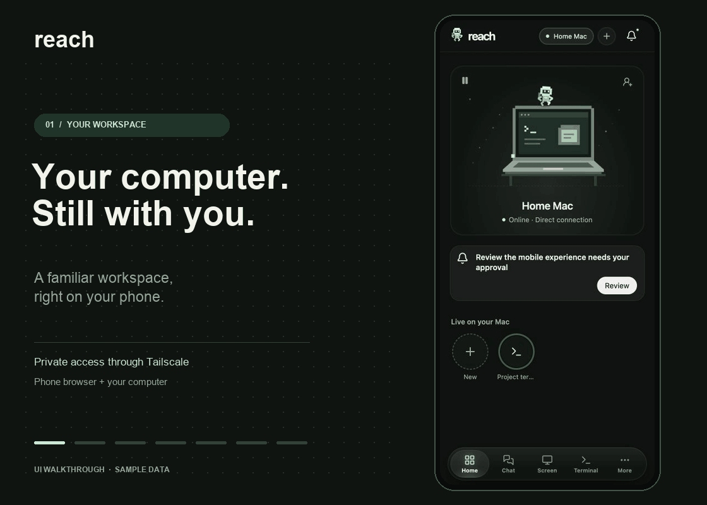

<p align="center">
  
</p>

<h1 align="center">Reach</h1>

<p align="center">
  <strong>Your Mac, for you and your agents. Wherever you are.</strong>
</p>

<p align="center">
  <a href="LICENSE"></a>
  
  
  
  
</p>

<p align="center">
  <a href="#give-agents-control-of-your-mac-with-cli-and-mcp">Agents: CLI &amp; MCP</a> ·
  <a href="#control-your-mac-from-your-phone">Control your Mac</a> ·
  <a href="#move-chats-between-claude-and-codex">Move chats</a> ·
  <a href="#quick-start">Quick start</a> ·
  <a href="#security">Security</a> ·
  <a href="docs/GUIDE.md">Full guide</a>
</p>

Give AI agents control of your **Mac apps, browser, files and terminals through CLI tools and MCP**. You choose what they can do, with scoped access secured by Tailscale.

Built for **fast, private connections between your devices**. Tailscale connects them directly when possible, reducing latency for smooth live control and responsive agent tools.

Bring **Claude, Codex, Grok, Muse, Dots or another agent**. Connect through Reach's CLI, MCP or its browser interface, depending on what your agent supports.

Control the same Mac from your phone with a sharp picture and smooth, real-time control at up to **60 fps**. Keep your **agent chats in one place** and **move chats between Claude Code and Codex with their history**. Free and open source, running on your Mac.

<p align="center">
  <a href="docs/media/reach-demo.mp4"></a>
  <br>
  <sub>Interface tour with sample data. <a href="docs/media/reach-demo.mp4">Watch the MP4</a>.</sub>
</p>

## Highlights

- **CLI tools and MCP to control your Mac.** Agents can open native apps, switch windows, click, type and use menus. Grant Full control or limit access to selected apps, folders or read-only actions.
- **Fast, private connections through Tailscale.** Encrypted device-to-device connections when available, for low latency and responsive control. Agents on your private tailnet benefit too.
- **Smooth control from your phone.** High-quality screen sharing at up to 60 fps, with touch, trackpad, zoom and your phone's keyboard.
- **Your agent chats, in one place.** Read and reply to Claude Code, Codex and OpenClaw chats from your phone. Move chats between Claude Code and Codex, send files and answer approvals.
- **Files and terminals, wherever you are.** Browse, share and upload files, run commands, and return to your Mac's open terminals.

## Give agents control of your Mac with CLI and MCP

Your agent can work on your actual laptop: native Mac apps, your signed-in browser, files and shell. Use the tools directly from the command line or through MCP, with the same permissions. Every tool call is checked against the access you grant, which you can pause or revoke from your phone.

1. On your phone, tap **Invite** on Home and choose **An agent**. Name it, pick a preset and how long it gets, keep **Connects: Tools**, then tap **Copy invite**.
2. Paste the invite into the agent. It runs one command in its terminal, on any computer with Node.js 22+.
3. Match the code it shows with the one on your phone under **Needs you**, and approve.

Once approved, the agent can list and call tools from the CLI; the join command also prints its MCP setup instructions. Ask it to open an app and fill a form, find a document, or run a project's tests. See the [agent setup guide](docs/AGENTS.md) and [full tool reference](docs/BROWSER_AGENT_TOOLS.md).

Each agent gets one **preset**:

| Preset           | The agent can                                            |
| ---------------- | -------------------------------------------------------- |
| **Full control** | Use the screen, apps, browser, files and a shell, as you |
| **Apps**         | See and use only the apps you pick                       |
| **Files**        | Read, or read and edit, only the folders you pick        |
| **Read only**    | Watch the screen and read shared files                   |

### Private tailnet or public Funnel

Agents with Tailscale support, including **Muse**, can join your private tailnet. With a native Tailscale connection, they can benefit from a direct path to your Mac and lower latency for tool calls, screen updates and file transfers. [Tailscale connects directly when possible](https://tailscale.com/docs/reference/connection-types), using encrypted relays when needed. Agents outside your tailnet can connect through an authenticated **Tailscale Funnel** link.

Reach's agent client prefers the private connection. If it starts over Funnel and later joins your tailnet, it automatically switches to the private route when detected, keeping the same permissions and MCP setup. Hosted MCP connectors use the URL configured in their service.

For an agent working through a browser, choose **Connects: Web page**: it gets your live screen and permitted controls in a page. For a service that takes a hosted MCP connector (claude.ai, ChatGPT), choose **Connects: Hosted** and add the URL it gives you (new, still being tested). See [agents](docs/AGENTS.md) and the [tool reference](docs/BROWSER_AGENT_TOOLS.md).

## Control your Mac from your phone

Open Reach in your phone's browser for high-quality screen sharing and smooth, real-time control at up to **60 fps**, secured by Tailscale. Click, drag, zoom, switch displays and type with your phone's keyboard. Reach adjusts to your connection to keep control responsive.

For the best connection, use the Tailscale app on your phone: it enables a direct device-to-device path when your network allows it. Browser sign-in also works through an encrypted relay. No Reach phone app or Reach account needed.

## Move chats between Claude and Codex

Start a conversation in Claude Code, then hand it to Codex to continue—or move it back. Reach carries the conversation history into the destination chat so the next agent can pick up the work. For long chats, recent messages are preserved and older history is condensed to fit.

From your phone, read and reply to Claude Code, Codex and OpenClaw chats, send files, and answer Claude and Codex approval requests. Keep the conversation moving alongside your Mac's apps, live screen and terminals. Install and sign in to each coding agent on your Mac first.

## Quick start

> **Tailscale is required.** Reach has no server of its own: your phone reaches your computer through [Tailscale](https://tailscale.com), a free private network. It must be installed and signed in on the computer. Setup walks you through it.

### What you need

|                     | Mac or Linux computer                                                     | Windows PC (experimental)                                                             |
| ------------------- | ------------------------------------------------------------------------- | ------------------------------------------------------------------------------------- |
| **On the computer** | [Tailscale](https://tailscale.com/download), signed in. macOS 13 or newer  | [Tailscale](https://tailscale.com/download/windows), signed in. Windows 10 or 11, x64 or ARM64 |
| **Your tailnet**    | MagicDNS and HTTPS certificates on (setup opens the page and waits)        | The same                                                                              |
| **On the phone**    | Just a browser. The Tailscale app is optional and faster                  | **The Tailscale app**, signed in to the same account and turned on                    |

From source, a phone without the Tailscale app signs in from its browser only if [Go](https://go.dev/dl/) was installed when Reach was built: Go builds that in-browser Tailscale client. The npm package includes it. On Windows it also needs Tailscale 1.104 or newer; with an older one, phones join with a pairing code and the app until Tailscale is updated, and Reach says so.

### What setup walks you through

The first run takes about 3 minutes. It shows three steps, then prompts you through each one. Ctrl+C stops at any point; run Reach again to pick up where you left off.

1. **Tailscale on this computer.** If Tailscale is missing, setup opens its download page; if you're signed out, its sign-in. Then it waits for you. On a Mac or Linux it also asks which Tailscale account your phones sign in with.
2. **Your private link.** Your tailnet needs MagicDNS and HTTPS certificates. If either is off, setup opens the one Tailscale page that turns them on, and waits.
3. **Your phone.** Reach starts and shows a QR code. Scan it with the phone's camera and tap **Connect**.
   - **Mac or Linux:** type the code your phone shows into the terminal to approve it. No Tailscale app on the phone? Sign in from its browser in the next 15 minutes (later: `reach pair`).
   - **Windows:** install the Tailscale app on the phone first and sign in with the same account. The QR carries a one-time code; press Enter for a new one.

The terminal says **✔ 3. Your phone — connected** when it's in. Later, when you want them: `reach setup invites` invites people and agents with a link, and `reach setup background` keeps Reach running after the window closes.

### Install

With [Node.js 22 or newer](https://nodejs.org/), on a Mac, a Linux computer or a Windows PC:

```sh
npm install --global @nalebc/reach
reach
```

`reach` sets everything up and shows the code that pairs your phone. New releases come to your phone under **Needs you**; `reach update` installs one from the terminal.

- **Mac:** allow **Screen Recording** and **Accessibility** when asked, so Reach can show and control the screen. Use [Tailscale 1.104](https://tailscale.com/changelog#2026-10-07) or newer.
- **Windows (experimental, not yet verified on a physical PC):** use Reach from your phone or another computer; opened on the PC itself, Screen would only show itself. Works on Windows: files, terminals, and the live screen with control. Built as on a Mac, with no setting to turn on, and passing on GitHub's Windows machines but not yet run on a physical PC: the live screen as H.264 video from Windows itself (where Windows has no H.264 encoder, [FFmpeg](https://ffmpeg.org/)'s video or still images, and the Screen page says why), phone sign-in from the browser, invite links for people and agents, Face ID sign-in and linked computers, the notification-area icon with Pause and Resume, app icons, document previews, voice memos, your own shell in terminals, and the Claude desktop app's chats. Built the same way, its Windows tests not yet run: background mode at sign-in, sleep prevention, one Reach per PC, restarts and updates in a window of its own, the PC's own terminals on the phone, and OpenClaw. Claude Code and Codex chats haven't been verified on Windows.

To build from source (for contributors) or run from a portable folder, see [Install in the guide](docs/GUIDE.md#install).

### Everyday commands

```sh
reach status    # where Reach runs, and its link
reach restart   # stop it and start it again
reach stop      # stop it
reach pair      # open pairing again, for another phone
reach setup     # change setup choices
```

From a source checkout, the same commands are `./reach …` (`.\reach.cmd …` on Windows). Linux and Windows details are in the [full guide](docs/GUIDE.md#install).

## Security

- **You control who connects.** Reach supports device approval and temporary pairing codes. The normal connection QR contains only an address; pairing QRs include a one-use code. Optional passkey sign-in is implemented, but Face ID on a real iPhone still needs testing.
- **Agents start with nothing.** You match a code to let one in. Its preset and end time are checked on every request, and you can pause or stop it from your phone. Pause an agent from your phone at any time, or pause Reach from the Mac's menu bar; while you control the Mac from your phone, agents wait.
- **Guardrails** keep agents' clicks and typing away from Reach and Tailscale, password managers and password fields, `sudo` and security prompts, and System Settings' security panes.
- **Full control is your account, not a sandbox.** Its shell runs as you. Give it only to agents you trust, and use **Apps** or **Files** for everything else.

Read the [security model](docs/SECURITY.md). To report a vulnerability, see [SECURITY.md](SECURITY.md).

## Platforms

| Host        | Status                                                                             |
| ----------- | ---------------------------------------------------------------------------------- |
| **macOS**   | Primary: screen, control, files, terminals, chats, agents                          |
| **Linux**   | Files, terminals and command-line agents; no screen or agent presets               |
| **Windows** | Experimental, not yet verified on a physical PC: guided setup, browser sign-in and invite links (Tailscale 1.104 or newer; otherwise a pairing code and the Tailscale app, with the reason), files, terminals, screen, background mode and sleep prevention |
| **Phone**   | Safari on iPhone, Chrome on Android. No app needed                                 |

## Docs

- [Full guide](docs/GUIDE.md): install options, pairing, background mode, configuration, limits
- [Remote desktop](docs/REMOTE_DESKTOP.md): gestures, video and performance
- [Agents](docs/AGENTS.md) and [browser-agent tools](docs/BROWSER_AGENT_TOOLS.md): presets, MCP setup, every tool
- [Agent CLI](docs/AGENT_CLI.md): short-lived access for cloud agents
- [HTTP API](docs/API.md) · [Security model](docs/SECURITY.md)

## Status

Early access (0.2.0). macOS comes first, and testing on physical phones is still in progress.

## Contributing

Issues and pull requests are welcome. Read [CONTRIBUTING.md](CONTRIBUTING.md) first. Run tests with `npm test`, or `npm run test:file -- test/x.test.mjs` for one file.

## License

[MIT](LICENSE)
